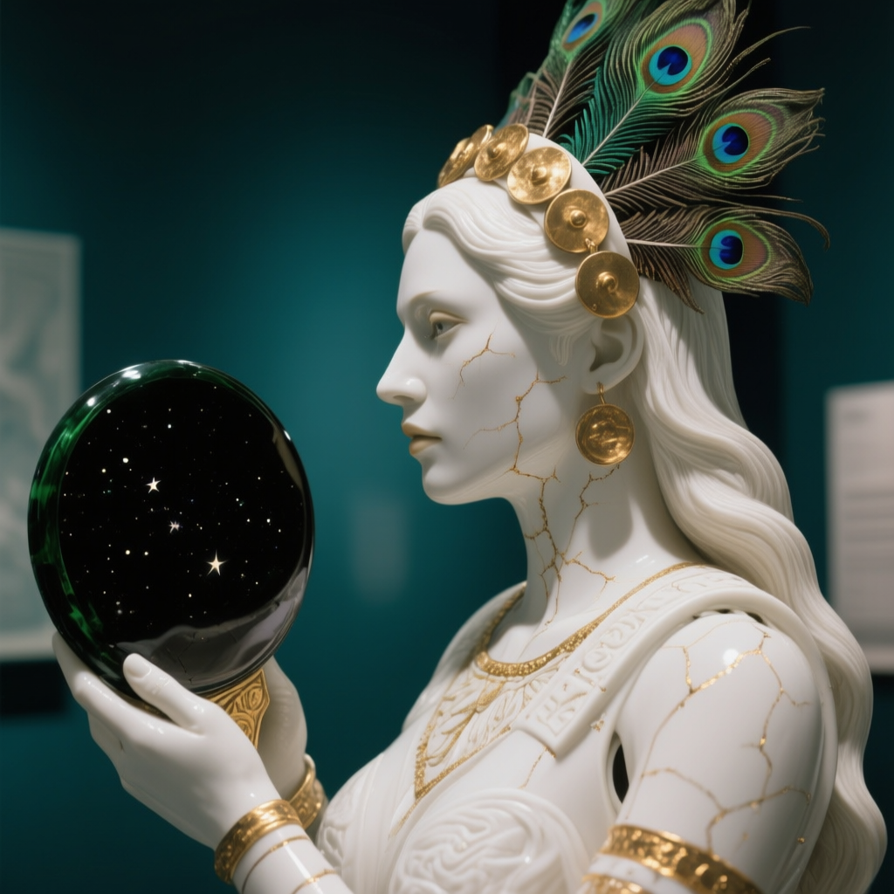

# Qwen-Image UI

A standalone Gradio UI for **Qwen/Qwen-Image** — the Qwen team's
20B text-to-image model — in the same shape as the other UIs in
this family (Kandinsky, Sana, Z-Image, SD 3.5, PixArt, FLUX.1,
Chroma, Wan). No Jupyter, no Colab: run it, a browser page
opens, type a prompt, hit Generate.

Qwen-Image's specialty is **text inside the picture** — signs,
posters, labels, book covers — rendered more reliably than any
other model in this family. It is a full-CFG model: the
negative prompt really works, driven by the True CFG scale
slider. The defaults are the model card's own: **50 steps,
true_cfg_scale 4.0, 1024x1024**.

The model is **Apache 2.0 and ungated**. No license to accept,
no token to paste, no login.

**STATUS: CODE VERIFIED ONLY.** This build has been benched
end-to-end on miniature weights and real repo files, but it
has not run on a real PC yet. The first-picture, small-queue,
and batch proofs below are still owed.

## Examples

Frame 000001 — the Aztec priestess (Qwen-Image, GGUF Q5_K_M, seed 1676890085). The model's first PC-proven frame.

## What's in the package

- `install.bat` — one-click installer (see below).
- `run.bat` — starts the app.
- `qwen-ui/app.py` — the whole app.
- `python_embeded/` — a bundled Python 3.12 (ComfyUI portable
  style). Nothing on your system is touched or needed.
- `requirements.txt` — the pinned package set.

## Install

1. Extract the zip somewhere plain, e.g. `C:\AI\qwen-ui`.
   The layout is *wrapped*: the folder you extract holds
   another `qwen-ui` folder inside it — that's normal, leave
   it as it is.
2. Double-click `install.bat`. It sets up pip in the bundled
   Python, installs PyTorch with CUDA support from PyTorch's
   cu130 index, then the pinned requirements. This is a big
   download; let it finish.
3. Double-click `run.bat`. The app opens in your browser at
   127.0.0.1 with the tab already up.

## First run — the three proofs, in order

First Generate downloads the model: about **31.8 GB** total
(the Q5_K_M GGUF transformer, 14.93 GB, from
city96/Qwen-Image-gguf; the text encoder, VAE, and tokenizer
from Qwen/Qwen-Image). It lands in the Hugging Face cache on
your user profile, not in this folder.

Prove it the family way, one session, in this order:

1. **First single picture.** Defaults exactly as the app
   opens: Q5_K_M precision, CPU offload ON, 1024x1024,
   50 steps, true_cfg 4.0. One prompt, one image.
2. **Small queue.** Two or three lines in the queue box,
   one image each.
3. **Batch.** One prompt, Images per prompt set above 3
   (4 is fine), still at 1024x1024.

After each step, the batch folder's `settings.txt` records
what actually ran — check that the precision line says
`gguf-q5` (or whichever you picked) on the first run, because
a fresh start always opens on the Q5 default.

Keep the browser tab open while a queue runs — closing the
tab stops the run. Minimized is fine. Closing the terminal
window stops the app itself.

## How it fits a 12 GB card with 32 GB of RAM

- The transformer loads from a quantized **GGUF** file with
  CPU offload: its weights park in system RAM and stream to
  the GPU block by block. **Q5_K_M (14.93 GB)** is the
  default. **Q6_K (16.82 GB)** buys a little detail for about
  1.9 GB more RAM; **Q4_K_M (13.07 GB)** is the lightest.
- The **text encoder loads FP8** (torchao weight-only): its
  BF16 form is 16.58 GB, which does not fit this RAM budget
  next to any transformer; FP8 parks it in about 8.9 GB.
- Total parked weights on the default path: about **24 GB**.
- Full BF16 is **not offered at all**: the BF16 transformer
  alone is 40.87 GB, more than the machine's 32 GB of RAM
  before the encoder even loads. Q8_0 (21.76 GB) is not
  offered either — with the encoder it would park about
  30.8 GB of weights.
- If a chosen GGUF load fails, the app falls back to Q4_K_M
  with offload forced on and **says so in the status line**
  and in `settings.txt`. It never falls back to BF16.

## Using the app

- **Prompt / Negative prompt** — the negative genuinely
  steers at True CFG above 1; at 1.0 it does nothing.
- **Queue** — one prompt per line; when the queue has lines
  it runs instead of the prompt box. All lines share one
  batch folder; every finished line appends its own block
  to `settings.txt`, so a stopped run's resume point is
  exact.
- **Images per prompt** — the batch control (1–10). A fixed
  seed S gives seeds S, S+1, S+2…; −1 draws fresh randoms.
- **{a|b|c}** in a prompt picks one option at random, fresh
  for every image.
- **History** — the last 10 prompts, pick one to reload it.
- **Star batch** — copies the most recent batch folder into
  `images_out/favorites/` under a fresh name; never
  overwrites.
- **Stop** — cancels the current run between images.
- **Unload models** — frees VRAM and RAM without closing
  the app.

Pictures land in `images_out/<batch name>/` next to
`run.bat`, frames numbered continuously across runs
(`000001.png`, `000002.png`, …), with `settings.txt`
appended once per finished prompt line.

## Notes

- There are **no LoRA slots in v1** — LoRA-on-GGUF under CPU
  offload is not a verified combination in this build, and a
  slot that silently does nothing is worse than no slot.
- Qwen-Image-Edit is a different model; if it comes, it will
  be its own app.
- Python 3.12 is required (Diffusers 0.42 dropped 3.10) —
  it's the bundled one; your system Python is irrelevant.
